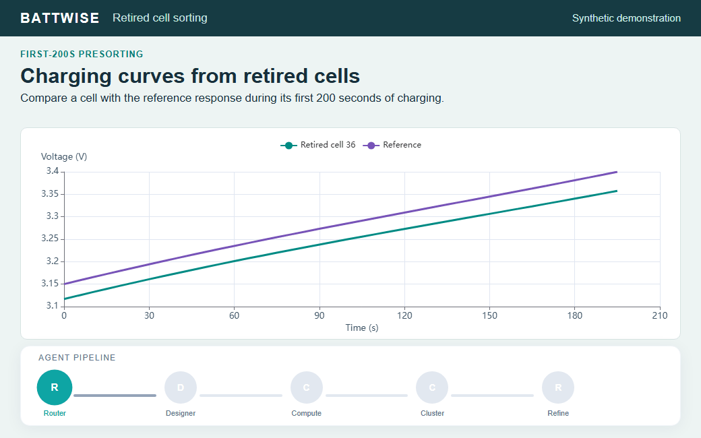
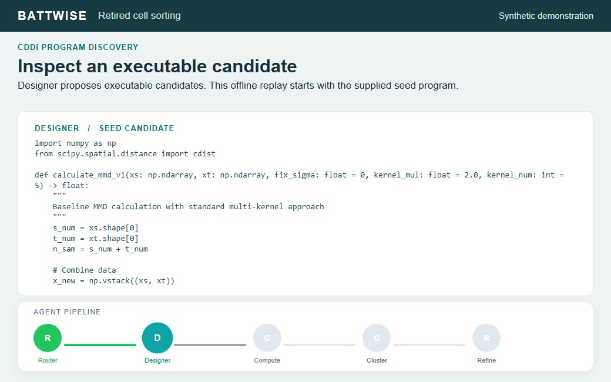

# BATTWISE

**Battery agentic triage and testing workflow with internal state evidence (BATTWISE)** sorts retired cells using their charging curves. First-200s presorting uses the first 200 seconds of charging. For a selected group, All-200 refinement uses 200 uniformly sampled current–voltage pairs from each complete curve.



The workbench replay follows a synthetic batch from a cell/reference curve comparison to one **charging curve distribution discrepancy indicator (CDDI)** per cell. GA-KMeans groups cells using CDDI, open circuit voltage (OCV) and internal resistance (IR). A second pass refines a selected group.

This is the **review-code-20261125** review distribution. It contains application
and experiment implementations, not the manuscript's saved result tables or
figures. See [release scope](docs/RELEASE_SCOPE.md) and
[known limitations](docs/LIMITATIONS.md) before interpreting reproducibility claims.

## Start here

| Task | Documentation |
|---|---|
| Install in a separate environment | [Installation](docs/INSTALL.md) |
| Run a small offline example | [Demo](docs/DEMO.md) |
| Run the application | [Application](docs/APPLICATION.md) |
| Inspect or rerun experiments | [Experiments](docs/EXPERIMENTS.md) |
| Prepare input tables | [Data contract](docs/DATA_FORMAT.md) |
| Understand evidence and version boundaries | [Reproducibility](docs/REPRODUCIBILITY.md) |
| Prepare an anonymous reviewer link | [Anonymous review](docs/ANONYMOUS_REVIEW.md) |
| Draft the manuscript statement | [Code availability](docs/CODE_AVAILABILITY.md) |

## What the code implements

1. Router and Planner interpret a user's request and maintain an interactive plan.
2. Designer discovers or revises a scalar curve-discrepancy program using a
   lightweight design pass or performance-guided reflective search.
3. Compute runs the program in a separate process with interface, finite-output,
   progress, and timeout checks.
4. Cluster groups cells using **OCV + IR + CDDI**.
5. Refine designs and evaluates an All-200 program for selected parent groups,
   then merges subgroup labels back into the global grouping.
6. Chat, contextual guidance, and conversation memory support human intervention
   throughout the workflow.

First-200s supports rapid screening. All-200 supports complete indicator discovery
and selected-group refinement. Capacity and the 33 external validation indicators
are evaluation-only. A 2 Ah threshold may select a refinement cohort; it is not an
input to CDDI discovery or clustering.

## CDDI program discovery

Router and Planner organize the tasks. Designer proposes executable programs that compare a cell curve with a reference response. Seventeen charging curve descriptors guide candidate scoring. Compute checks and executes the selected program. The formal All-200 benchmark reports the frozen method as **BATTWISE-CDDI**.



This offline illustration evaluates the supplied seed on synthetic First-200s curves. The refinement illustration uses the frozen All-200 executable on the selected subset. These workbook-free examples illustrate the interfaces of dataset-specific programs.

## Repository layout

```text
app/backend/                         FastAPI, agents, orchestration, services, tests
app/frontend/                        React/TypeScript interface
battwise_cddi_search/                CDDI program discovery in the Designer
experiments/fair_1d_benchmark/       Data loading, representations, GA-KMeans, metrics
experiments/statistics/              Friedman, paired Wilcoxon/Holm, stability, ARI
programs/cddi/                       Frozen selected executable CDDI program
comparisons/funsearch/               Preserved candidate code and scope explanation
battery_compute/                          Compute reference code, without measured data
examples/                           Deterministic synthetic offline demo
scripts/                            Release checks
docs/                               Installation, protocols, scope, limitations
deploy/                             Localhost launch scripts
```

Search problems and prompts live under `battwise_cddi_search/problems/battery_cddi/`
and `battwise_cddi_search/prompts/battery_cddi/`. Configuration names use
`config_battery_cddi`. Upstream EoH and FunSearch retain their original names and
attribution in [third-party notices](THIRD_PARTY_NOTICES.md). Historical function
identifiers remain compatible with saved programs; the frozen CDDI code is unchanged.

## Quick offline demo

After installing the core dependencies:

```bash
python examples/demo_cddi.py
```

The demo generates synthetic two-channel curves in memory, checks the frozen
program's source hash, and prints finite scalar outputs. It does not call an LLM,
train a model, run a search, or reproduce a manuscript experiment.

## Tests

```bash
python scripts/test_offline.py
```

The command checks the release, frozen CDDI demo, benchmark contracts, renamed
paths and all seven search configurations, both First-200s and All-200 evaluators
on temporary synthetic workbooks, compatibility, and CLI startup. It exits
nonzero on a failed check and needs no dataset download, API key, or LLM request.

After installing the optional benchmark dependencies, include all benchmark tests:

```bash
python scripts/test_offline.py --full
```

Other application integration tests may require measured inputs or provider
credentials. See [validation](docs/VALIDATION.md) for the checks actually run.

## Licensing and publication

BATTWISE-authored code is released under the [MIT License](LICENSE). Bundled
third-party code retains its upstream notices and license. No claim is made that
this new repository commit is the historical commit used for formal experiments.
For publication, freeze the relevant revision and archive that version in a
DOI-minting repository. This review package does not yet have a DOI.

The current code-only scope intentionally omits measured datasets, saved
experimental outputs, figures, plotting pipelines, runtime sessions, logs,
credentials, build products, and historical Git metadata.
