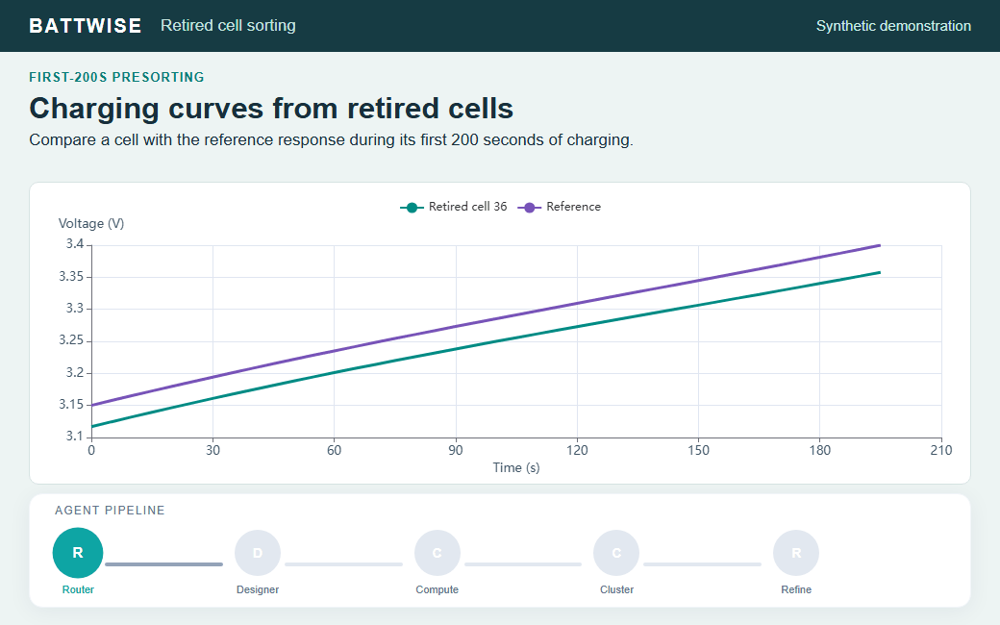
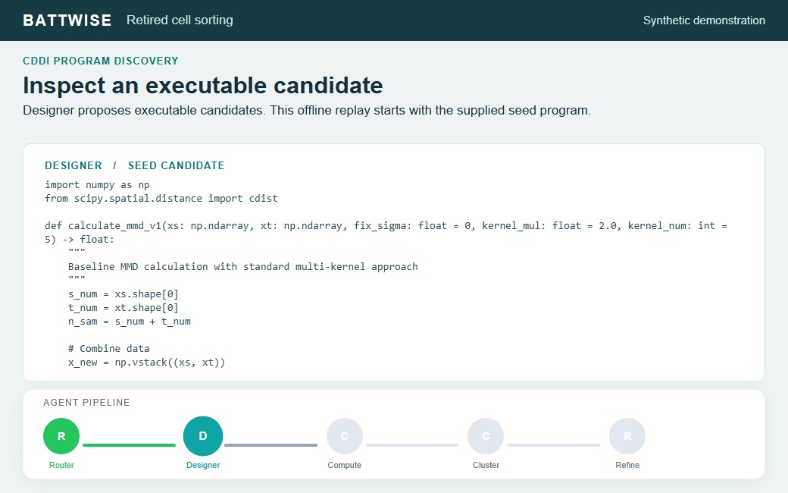

# BATTWISE 代码审稿包

**Battery agentic triage and testing workflow with internal state evidence (BATTWISE)** 用充电曲线对退役电芯进行预分选，再对选定的组进行精分。First-200s 取充电开始后的 200 秒，All-200 从完整充电曲线均匀采样 200 对电流、电压值。



Router 和 Planner 组织任务，Designer 提出可执行的候选程序，用 17 个充电曲线描述符指导评分。Compute 检查并运行程序，每个电芯得到一个充电曲线分布差异指标（charging curve distribution discrepancy indicator，CDDI）。Cluster 用 OCV、IR 和 CDDI 进行 GA-KMeans 分组。正式 All-200 基准中的方法名为 **BATTWISE-CDDI**。



动画回放采用合成数据。短窗口示例运行仓库中的种子程序，精分示例在选定组上运行冻结的 All-200 程序。
完整入口见 [英文 README](README.md)。

## 安装后直接测试

在仓库根目录执行：

```bash
python -m pip install -r requirements.txt
python scripts/test_offline.py
```

测试使用临时合成数据，实际运行 CDDI 计算、First-200s 与 All-200 评估、
配置加载、兼容回归及入口启动，不需要 API key 或真实实验数据。
任一检查失败会返回非零退出码。安装可选 PyTorch 依赖后，可执行
`python scripts/test_offline.py --full` 加入全部基准方法单元测试。

搜索目录为 `battwise_cddi_search/`，内部问题及提示词目录为 `battery_cddi/`，
计算模块目录为 `battery_compute/`。导入、配置和文档路径同步更新。

## 本轮包含

- 多智能体系统、前端、路由、规划、对话与流程状态管理。
- CDDI 设计、隔离计算、反思搜索核心、提示词和电池评估接口。
- OCV + IR + CDDI 聚类、选中父簇的 All-200 精分与标签合并。
- 冻结 CDDI 可执行程序及源码哈希。
- 实验数据加载、预处理、比较方法、共享 GA-KMeans、指标与统计检验代码。
- 依赖、MIT 许可、第三方署名、合成示例与验证说明。

## 本轮排除

真实电池数据、实验结果表、统计输出、论文图片、绘图项目、模型检查点、
搜索日志、历史会话、密钥配置、原始 Git 历史和本机运行环境均不上传。
前端中的图表组件属于应用代码，和论文绘图项目分开处理。

## 已明确的边界

- 当前包不能单独替代完整数据发布。
- 现有 FunSearch 材料仅有候选函数，缺少完整搜索入口与已核验实验协议；
  不将其表述为完整复现。
- 冻结 CDDI 接收原始电芯/参考曲线；其他表示方法使用标准化残差矩阵。
  论文中的统一输入表述需要与代码保持一致。
- 当前版本包含命名兼容和反思回调修复，不能把新提交称为历史正式实验提交。

安装见 [INSTALL](docs/INSTALL.md)，实验入口见 [EXPERIMENTS](docs/EXPERIMENTS.md)，
发布范围见 [RELEASE_SCOPE](docs/RELEASE_SCOPE.md)，
验证结果见 [VALIDATION](docs/VALIDATION.md)。
